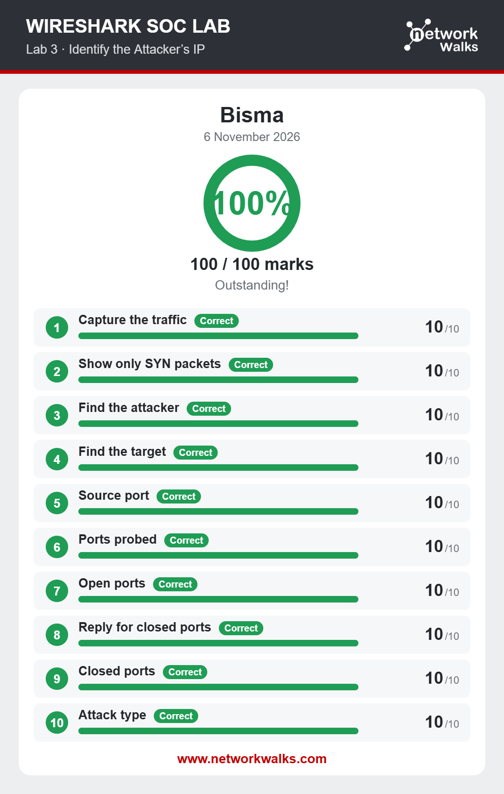
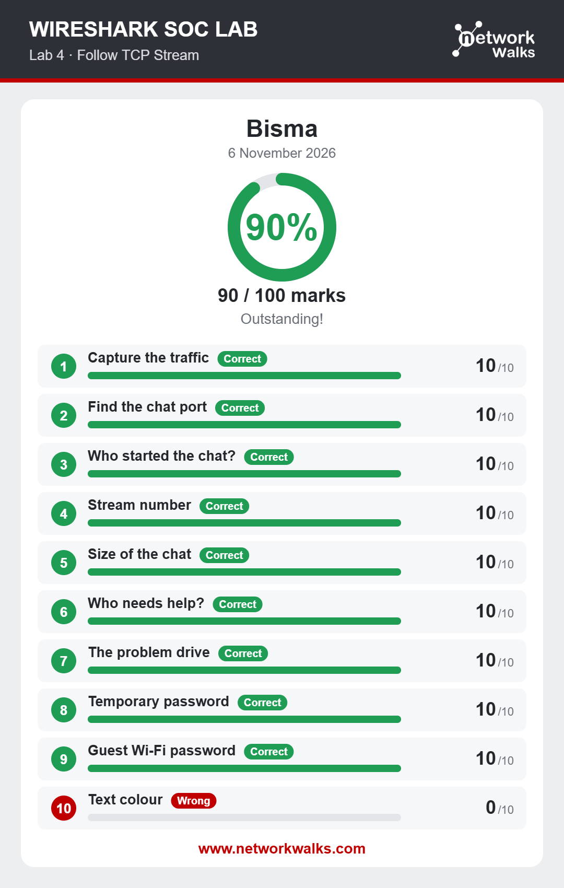
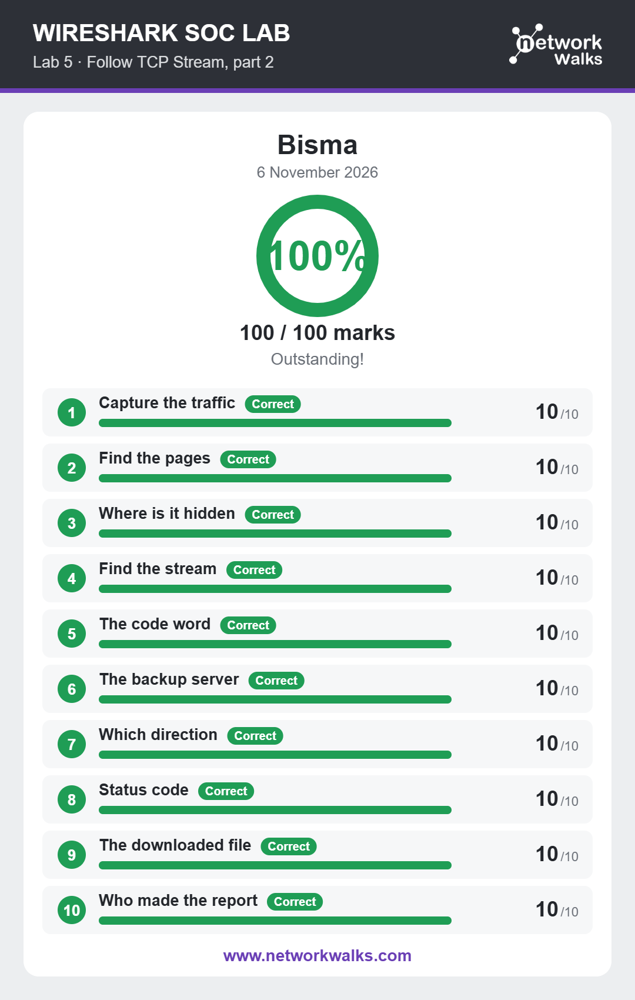
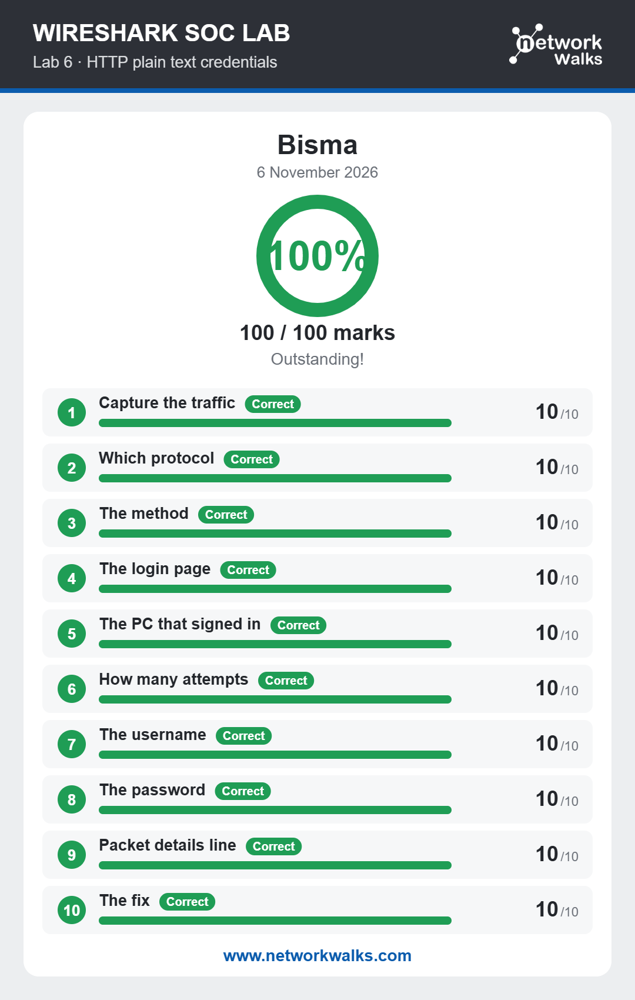
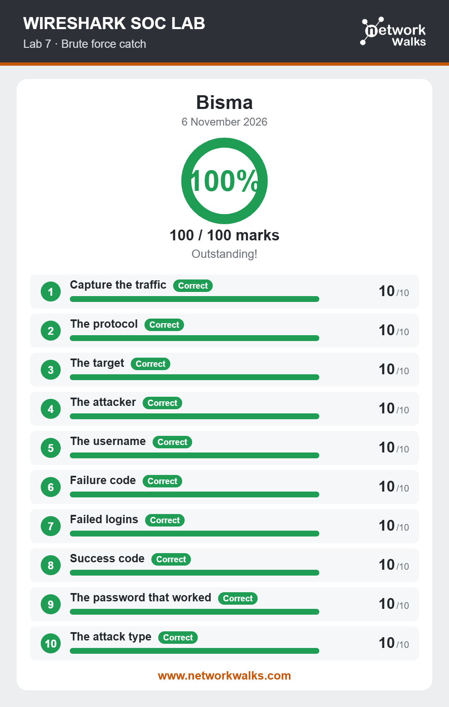
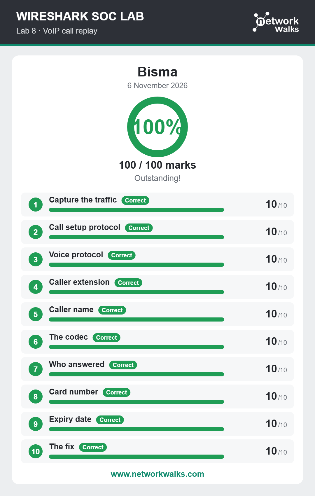

# Wireshark SOC Lab Results

A collection of completion screenshots from the **Wireshark SOC Lab** exercises (Labs 3–8). These labs focus on packet analysis and identifying common network-security indicators using Wireshark.

## Overview

| Lab | Topic | Result |
|---|---|---:|
| Lab 3 | Identify the Attacker's IP | 100/100 |
| Lab 4 | Follow TCP Stream | 90/100 |
| Lab 5 | Follow TCP Stream, Part 2 | 100/100 |
| Lab 6 | HTTP Plain-Text Credentials | 100/100 |
| Lab 7 | Brute-Force Detection | 100/100 |
| Lab 8 | VoIP Call Replay | 100/100 |
| **Total** | **6 labs** | **590/600 (98.3%)** |

## Skills Practiced

- Capturing and inspecting network traffic
- Filtering and analyzing TCP packets
- Following TCP streams to understand application conversations
- Identifying suspicious source and destination activity
- Recognizing HTTP traffic and exposed credentials in a lab environment
- Detecting brute-force login patterns
- Examining VoIP signaling and call-related traffic

## Repository Structure

```text
wireshark-soc-lab-results/
├── README.md
├── .gitignore
└── results/
    ├── Lab-03-Identify-Attackers-IP.png
    ├── Lab-04-Follow-TCP-Stream.png
    ├── Lab-05-Follow-TCP-Stream-Part-2.png
    ├── Lab-06-HTTP-Plain-Text-Credentials.png
    ├── Lab-07-Brute-Force-Detection.png
    └── Lab-08-VoIP-Call-Replay.png
```

## Lab Evidence

### Lab 3 — Identify the Attacker's IP


### Lab 4 — Follow TCP Stream


### Lab 5 — Follow TCP Stream, Part 2


### Lab 6 — HTTP Plain-Text Credentials


### Lab 7 — Brute-Force Detection


### Lab 8 — VoIP Call Replay


## Tools

- Wireshark
- Network packet analysis and display filters

## Disclaimer

These screenshots document learning activities performed in a controlled lab environment. Network analysis and security testing should only be conducted on systems and traffic you own or are explicitly authorized to examine.

## About

This repository is intended as a portfolio record of practical SOC and network-traffic analysis exercises.
